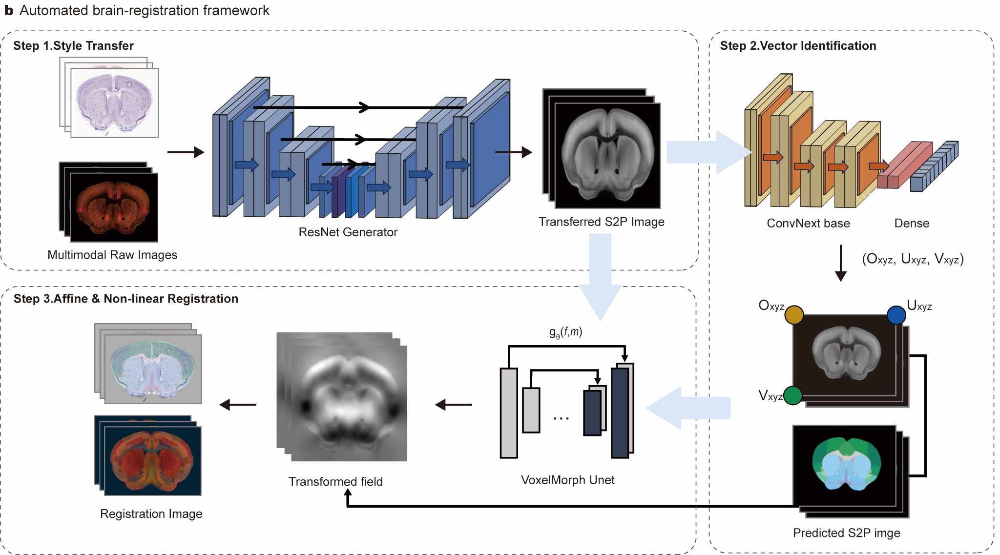
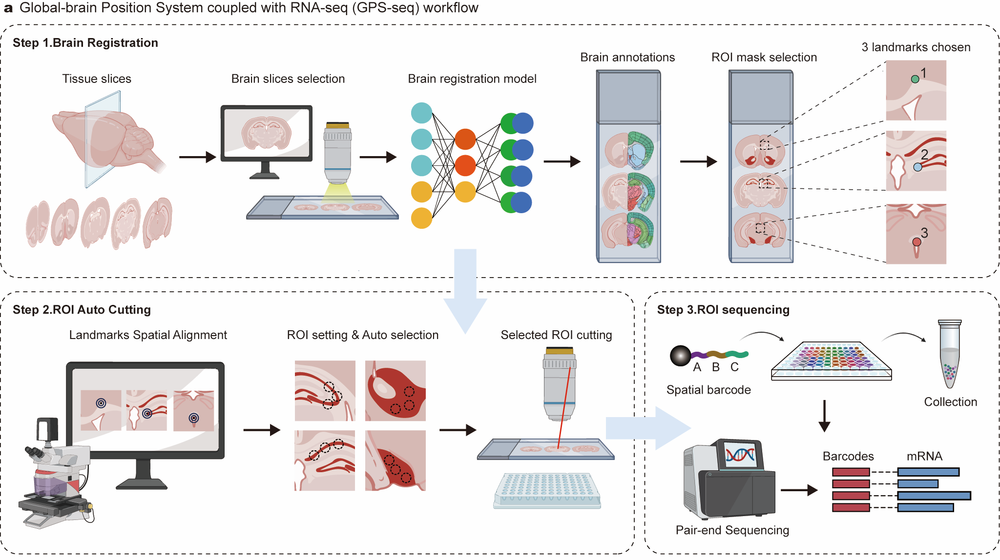

# GPSseq

### GPS-seq maps brain-wide transcriptional networks to guide schizophrenia therapeutic strategy

[](https://www.python.org/)
[](https://www.tensorflow.org/)
[](https://atlas.brain-map.org/)

**GPS-seq** (*Global-brain Position System coupled with RNA sequencing*) combines deep-learning-based brain atlas registration, laser capture microdissection (LCM), and spatially barcoded transcriptome recovery for brain-region-resolved transcriptomic profiling.

This repository provides the GPS-seq brain-registration software, installation tools, and Allen Mouse Brain Atlas preparation notebooks.

## GPS-seq workflow



*Figure 1. GPS-seq registration framework: ResNet-based image translation, ConvNeXt-based spatial localization, and VoxelMorph-based affine/deformable registration.*



*Figure 2. Software workflow for atlas registration, landmark calibration, ROI selection, and LCM-compatible XML export.*

## Quick start

The GPSseq development environment uses **Python 3.9**, **TensorFlow 2.16.1**, **Keras 3.9.0**, and the GPSseq-compatible Neurite and VoxelMorph sources in `third_party/`. The current setup targets Windows.

### 1. Create a Python environment

Using Conda or Miniconda:

```bash
conda create -n gpsseq python=3.9 -y
conda activate gpsseq
```

### 2. Download GPSseq

```bash
git clone https://github.com/YOUR_USERNAME/GPSseq.git
cd GPSseq
```

Replace `YOUR_USERNAME` with the repository owner. Alternatively, download the repository ZIP from GitHub.

### 3. Install Python dependencies

Run from the GPSseq repository root:

```bash
python -m pip install -r requirements.txt
```

### 4. Install GPSseq-compatible Neurite and VoxelMorph

Open [`tutorials/01_install_environment.ipynb`](tutorials/01_install_environment.ipynb) using the `gpsseq` Python environment and run the cells in order.

The notebook installs `third_party/neurite-gpsseq-legacy.zip` and `third_party/voxelmorph-gpsseq-legacy.zip`, then checks `neurite.layers.Constant` and `VxmAffineFeatureDetector`.

Alternatively, run from the repository root:

```bash
python -m pip install --no-deps --force-reinstall ./third_party/neurite-gpsseq-legacy.zip
python -m pip install --no-deps --force-reinstall ./third_party/voxelmorph-gpsseq-legacy.zip
python scripts/verify_installation.py
```

Continue only after installation verification succeeds. For the source snapshot, see [`third_party/SOURCE_INFORMATION.md`](third_party/SOURCE_INFORMATION.md).

### 5. Download the Allen Mouse Brain Atlas

Before starting, ensure the following annotation file is available:

```text
brain_registration/metadata/Allen_nrrd/brain_region_annotations.csv
```

Open [`tutorials/02_prepare_allen_atlas.ipynb`](tutorials/02_prepare_allen_atlas.ipynb) and run the cells in order. Downloads are disabled by default:

```python
RUN_DOWNLOADS = False
```

After confirming the output folders and available disk space, change it to:

```python
RUN_DOWNLOADS = True
```

For an initial test, use `MASK_LIMIT = 5`; set `MASK_LIMIT = None` for the complete collection.

The notebook retrieves the following public Allen Institute data:

| Reference data | Resolution |
| --- | --- |
| `annotation_10.nii.gz` | 10 µm |
| `average_template_10.nii.gz` | 10 µm |
| `annotation_boundary_10.nii.gz` | 10 µm |
| `average_template_25.nrrd` | 25 µm |
| `annotation_25.nrrd` | 25 µm |
| `structure_*.nrrd` | 25 µm |

After preparation, the atlas files are stored under:

```text
brain_registration/metadata/
├── Allen_nii/
│   ├── annotation_10.nii.gz
│   ├── average_template_10.nii.gz
│   └── annotation_boundary_10.nii.gz
└── Allen_nrrd/
    ├── brain_region_annotations.csv
    ├── average_template_25.nrrd
    ├── annotation_25.nrrd
    └── mask/
```

### 6. Download pretrained model weights

Large model weights are not included in the GitHub repository.

**Download:** `TODO: ADD MODEL-WEIGHTS URL`

Place the downloaded files at the paths required by `brain_registration/initialize_models.py`. Keep the expected filenames unchanged.

### 7. Run GPSseq

GPSseq provides a graphical interface for users. After completing the environment setup, preparing the Allen atlas data, and downloading the pretrained model weights, launch the application from the GPSseq repository root:

conda activate gpsseq
python app.py

app.py launches the interface defined in controller.py.

From the home screen:

Enter BrainRegistration: run the brain-registration workflow, including automatic registration and manual refinement.
Enter Combined Workflow: select calibration points, process ROIs/shapes, and generate LCM-compatible XML files.

Select the required input files and output folders in the interface, then follow the on-screen steps. Ensure the Allen atlas data, pretrained model weights, and application assets are available at the paths expected by GPSseq before launching.

### 8. Optional: Build a Windows executable

If you prefer the Windows application, run from the repository root:

```bash
pyinstaller app.spec
```

The build output is normally placed in `dist/`. Keep the external atlas data and model weights available at the paths required by the application.

## Notes

Allen atlas data, trained weights, Python caches, and PyInstaller build output should not be committed to the source repository. Keep the corresponding entries in `.gitignore`.

If Neurite or VoxelMorph installation fails, rerun `tutorials/01_install_environment.ipynb` and check the verification output.

## Citation

If you use GPSseq, please cite the associated manuscript:

> **GPS-seq maps brain-wide transcriptional networks to guide schizophrenia therapeutic strategy**

Full publication details and DOI will be added when available.

## Contact

For questions, use the contact information associated with the manuscript or open an issue in this repository.
